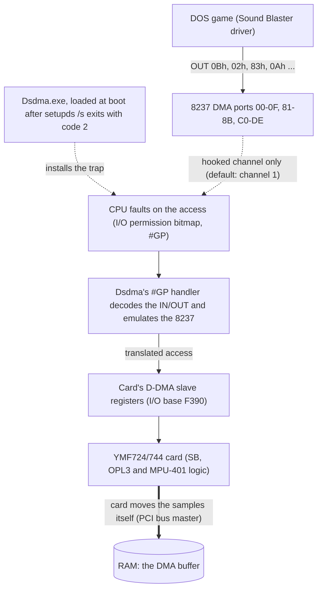

# ymf-dos-research — how Yamaha's DSDMA.EXE makes YMF724/744 sound cards work in DOS

Reverse-engineering notes on two DOS programs Yamaha shipped in 1999 to make its YMF724/YMF744 PCI sound
cards (the DS-1 family) work with old DOS games: `Dsdma.exe` and `setupds.exe`. The goal is a clear, sourced
description of how they work, so others can understand them, patch them or write replacements.

## Background: what these programs are for

**The problem.** DOS games expect a Sound Blaster: a card answering at I/O port 220h, interrupt 5, and DMA channel 1,
where the DMA channel belongs to the PC's ISA DMA controller (an Intel 8237 or its chipset equivalent). A PCI sound
card has no ISA slot and no ISA DMA channel. The YMF724/744 therefore includes Sound Blaster, OPL3 FM and MPU-401
hardware ("legacy audio") for old software, and relies on the *chipset* to deliver the DMA.

**Distributed DMA (D-DMA).** In one of the card's DMA modes, the card keeps its own copy of the DMA controller's
registers (the *slave*) at an I/O address on the PCI bus. The chipset (the *master*) is supposed to catch the game's
reads and writes to the normal 8237 ports and redirect them to that slave, then move the data over PCI. Intel's
PIIX4 and a few other chipsets of that era do this in hardware. Machines without that support get no DMA, so a
DOS game's sound never starts or hangs. That is the case for most PCs built since.

**What Yamaha shipped to cover that gap.**
- **`setupds.exe`** is the configuration and bring-up utility. It reads `ds.ini`, resets and powers up the card,
  assigns its I/O resources, enables the legacy Sound Blaster/FM/MPU blocks, picks a DMA mode and runs a self-test. In
  its boot-time form (`setupds /s`, called from `LOADTSR.BAT`) it finishes with exit code 2 on a chipset it does not
  recognise, which tells the batch file to load the next program.
- **`Dsdma.exe`** is a TSR (terminate-and-stay-resident program) that does the chipset's job *in software*. It
  switches the card to D-DMA mode, enters protected mode through VCPI (the interface DOS memory managers such as
  EMM386 expose), arranges for the CPU to fault on 8237 port accesses, and in the fault handler forwards each access to
  the card's slave registers.

**How the pieces fit together.**

The game also talks to the card directly for Sound Blaster commands (port 220h, interrupt on IRQ 5), which is not
trapped. For its DMA setup, the game believes it is programming the PC's DMA controller. For the one channel Dsdma hooks (channel 1 by default; the
others pass through to the real controller), it intercepts those port accesses and applies them to the
card's own copy of the DMA registers, and the card then moves the audio data itself. Findings 15 and 16 verify the
trap path in an emulator (the faulting access, the handler, the return to the game). The forwarding to the slave
registers is read from the disassembly and the data movement follows the datasheet, because the emulator has no
D-DMA slave to observe.

**Why this research.** Modern PCIe systems have neither ISA slots nor chipset D-DMA, so a PCI sound card gives a DOS
game nothing without something like `Dsdma.exe`. It is a rare, closed-source, vendor-written example of this approach (open projects such as SBEMU take related
routes, compared in Finding 18).
Documenting exactly how it and `setupds.exe` behave is the basis for understanding, debugging and replacing them.
Everything here was worked out from the binaries, the Intel and Yamaha datasheets and emulator runs.

Terms: **TSR** = a DOS program that stays in memory after it exits; **VCPI** = the DOS interface for running 32-bit
protected-mode code next to a memory manager; **8237** = the PC's DMA controller; **D-DMA / PC/PCI DMA** = the two
chipset-assisted DMA modes the card supports.

## What we learned
What the research adds up to, with the findings and the kind of evidence behind each point.

1. **Dsdma is a hypervisor-lite stacked on the memory manager, not a driver in the usual sense.** It uses VCPI to get
   into protected mode, then edits the memory manager's own TSS and interrupt table in place so that DMA port accesses
   fault into its code. It needs a VCPI memory manager (EMM386, Jemm, QEMM) underneath it. *(verified: Findings 15, 16)*
2. **It also replaces VCPI with its own DPMI host, which is why protected-mode games work.** A plain VCPI program is
   not trapped at all, so Dsdma hides VCPI and answers as a DPMI 0.9 host; DOS extenders then run under it and
   their port I/O is caught. Our earlier notes had this wrong (Dsdma does not sit "below" every extender), and
   Finding 19 corrected it. *(verified in emulation with DOS/4GW, PMODE/W and DOS/32A: Findings 19-21)*
3. **A replacement needs far less DPMI than the original contains.** Dsdma implements essentially the whole DPMI 0.9 API, but
   the three extenders we tried needed about 25 INT 31h functions. That bounds the size of an open-source replacement.
   *(verified for those three extenders only; real games are untested: Finding 21)*
4. **Simpler trapping tools stop short.** Jemm's QPI port-trap interface reaches real-mode and V86 programs but not
   protected-mode clients, so it cannot replace Dsdma for 32-bit DOS games. It also conflicts with Dsdma on the same
   ports (loading Dsdma and then QPIEMU hung our V86 probe; cause unknown). *(verified: Findings 17, 19, 20)*
5. **`ds.ini` is mostly decoration.** `setupds` reads and writes it, but Dsdma never does and hardcodes Sound Blaster
   port 220h, IRQ 5, DMA 1 and slave base F390. Non-default choices made in `setupds` would be silently overwritten when
   Dsdma loads (stock settings happen to coincide, so default setups are unaffected). *(static analysis: Findings 8, 13;
   the end-to-end effect is inferred)*
6. **The card's interrupt is a PCI interrupt wearing an IRQ 5 label.** With the stock `ds.ini`, `setupds` routes the
   Sound Blaster block's interrupt over PCI INTA# and sets the interrupt controller to level mode; Dsdma leaves that
   alone. A replacement or a new machine's BIOS setup must keep that routing. *(verified in disassembly: Finding 14)*
7. **On an unrecognised chipset, `setupds`' own DMA self-test is expected to fail.** It leaves the card in a reserved
   DMA mode until Dsdma switches it to D-DMA, so a failed test there is not by itself evidence of a fault.
   *(inferred from the code; not observed on hardware: Finding 13)*
8. **Dsdma never issues a D-DMA Master Clear or Request.** That is the starting hypothesis for an unreliable first
   DMA after load (see the open question below). *(verified statically: Findings 1, 4; the link to the symptom is not established)*

How the work was done matters too: every emulator result can be re-run and checked with
`harness/verify.sh` (see `experiments/README.md`), and several findings were later corrected by testing
(Finding 19 overturned parts of Findings 3 and 15, and the datasheet settled the register offsets in Finding 5).
"Using this repo" below explains the evidence tags.

## The open question that started this
The research began with a symptom on real hardware: with Dsdma loaded, the first game to use DMA after boot could hang
(Doom, at the end of its demo), while running another game first (Duke Nukem 3D) made everything work for the rest of
the session. One hypothesis was that Dsdma never resets the card's D-DMA slave registers (a "Master Clear") when it loads.

- **Established:** Dsdma contains no Master Clear or Request code path (Findings 1, 4). In the emulated run its only
  PCI config writes on load are `0x42 = 1000` and `0x4C = F391` (Finding 16); the slave itself is not emulated.
- **Not established:** that this missing reset causes the symptom. The one hardware session was inconclusive
  (Finding 7); the test protocol is in Finding 6. Until it is run on real hardware, treat the cause as an open hypothesis.

## Quick answers
The individual questions the findings settle, as a lookup.

| Topic | Result | Finding |
|---|---|---|
| Does Dsdma issue a D-DMA Master Clear or Request? | Statically: no such code path exists. | 1, 4 |
| Does Dsdma read `ds.ini`? | No. All settings are hardcoded (SB 220, IRQ 5, DMA 1, slave base F390). | 8 |
| What does `setupds /s` do and when does it launch Dsdma? | Programs the card, then exit code 2 on an unknown chipset triggers `loadtsr.bat`. | 11-13 |
| How are 8237 ports trapped? | VCPI host takeover, TSS I/O permission bitmap and a hooked #GP handler. | 15, 16 |
| Do traps reach protected-mode games? | Not through VCPI clients. Dsdma is also a DPMI 0.9 host so extenders run under it. | 19-21 |
| Alternatives (Jemm QPI, SBEMU) | Compared and analysed. | 17, 18 |

## Using this repo
**Where to start.** Findings are in `findings/NN-*.md`, in the order they were made. Start with Finding 13 (end to end),
then 15 (how the trap works) and 21 (the DPMI host). Later findings correct earlier ones, and the corrections are noted
in both places. Claims are tagged **verified** (seen directly in disassembly or an observed run), **inferred**
(reasoning only) or **not tested**.

**Reproducing the results.** Dynamic checks used DOSBox-X, FreeDOS 1.3 and Jemm; see `harness/README.md` and
`experiments/README.md`. The D-DMA slave itself is not emulated there, so register-level behaviour of the card is
only confirmed from the datasheets and the static analysis. `docs/reproducing.md` explains how to regenerate everything
that is not shipped, and `docs/roadmap.md` has status, open questions and next steps. "The earlier notes" in some
findings means the maintainer's unpublished notes from the first real-hardware bring-up of the same card.

**What is and is not in this repo.**
- Included: our written findings, short disassembly excerpts (`findings/excerpts/`), Ghidra scripts and an LE parser
  (`tools/`), the test harness and experiments, and the D-DMA reference we transcribed (`docs/piix4-ddma-reference.md`).
- **Not included:** the Yamaha binaries and the vendor datasheet PDFs. Run `samples/ymf744/fetch.sh` to download and
  hash-check the driver package, and see `docs/datasheets.md` for the PDFs.
- Full disassembly listings are not shipped. `tools/regen-listings.sh` rebuilds them from the fetched binary with `ndisasm`.

## What's next
A behavioural spec for a replacement TSR (`OpenDSDMA`) will be written from these findings
and the datasheets, then implemented separately from it.

## Licence
- Written material (findings, docs, READMEs, recorded results): [CC BY 4.0](LICENSE-docs.txt).
- Code (harness, tools, test programs, scripts): [MIT](LICENSE).
- The Yamaha software and datasheets are not included and remain the property of their owners. Short disassembly
  excerpts in `findings/excerpts/` are quoted for commentary and research.

## Author
James Mackenzie. Contributions and corrections welcome.
